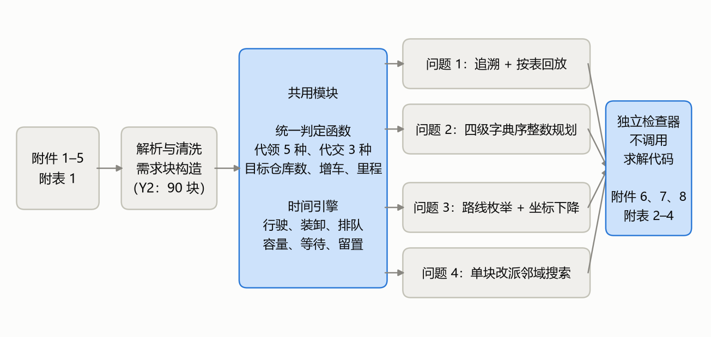

# 一、问题重述

## 1.1 背景

货物调运是需求单位开展年度训练任务的保障环节。各需求单位按批次提报调运需求：一个批次由一支调运梯队执行，从驻地出发，到若干目标货物仓库接领或送交货物，再回到队属货物仓库卸货、存储，最后返回驻地。业务部门的任务是对各单位的提报统筹优化：让顺路的单位“顺带”帮别人代领代交，从而减少批次和目标仓库；再为每个批次规划路线和实施时间，并对计划作定量评估。

## 1.2 数据

| 数据 | 内容 | 规模 |
|---|---|---|
| 附件 1 | 驻地、队属仓库、后方仓库之间的直达距离 | 12 个单位驻地、7 个队属仓库（WO–WU）、14 个后方仓库（WA–WN） |
| 附件 2、3 | Y1 年度统筹前的提报需求、业务人员统筹后的计划 | 统筹前 32 批，统筹后 27 批 |
| 附件 4 | Y2 年度统筹前的提报需求 | 46 批，按“批次—仓库—方向—存放仓库”拆成 90 个需求块（接领 72、送交 18），原有批次-仓库对 73 个 |
| 附件 5 | 各单位车型装载单品种货物的最大数量 | 245 种货物 |
| 附表 1 | 各单位可使用的队属仓库 | 7 个队属仓库中 4 个由多个单位共用 |

距离矩阵不满足三角不等式：528 个节点对中有 236 对（44.7%）的表列值大于经第三点中转的和，差值中位数 51 km。例如 WE 到 WO 表列 765 km，而经 WF 中转只有 453 km；WP 到 WA 表列 550 km，经驻地 U6 为 15 + 505 = 520 km。若表列值是真实最短路程，这种情况不会出现，所以表列值应理解为题目给定的两点间行车里程，而不是路网最短路。路过某地本身没有问题；问题在于能否用中转后的和代替表列值计里程。本文按字面取表列值：里程按结果表所列各站逐段取附件 1 的值相加，与件 7 注 2“依次填入经过的货物仓库直到回到驻地”一致，评阅时可以直接复核；借道中转作为对照（第八、十章）。<!-- 内部：tools/tri_check.py → results/F/checks/tri_violations.csv -->

## 1.3 要解决的问题

1. **问题 1**：分析附件 2 到附件 3 的统筹是怎样形成的，定义评价指标，评估统筹效果和实施风险。
2. **问题 2**：对 Y2 的提报需求，不考虑实施时间，权衡代领代交总量与批次数，使批次尽可能少；结果填入附件 6，并给出附表 2 的四项指标。
3. **问题 3**：保持问题 2 的分配不变，规划每个批次的路线和实施时间，以载货车辆总行驶距离、人员调动执行总时间、实施时间与提报时间的一致性为目标；结果填入附件 7，并给出附表 3 的四项指标。
4. **问题 4**：重新统筹，联合决定分配、路线和时间，在问题 2、3 的目标之外再考虑代领代交的均衡性和批次-仓库对的数量；结果填入附件 8，给出附表 4 的十项指标，并与问题 3 的方案定量比较。

# 二、问题分析

## 2.1 四问的关系

四问由浅入深，共用三层决策：

| 层 | 决策 | 问题 1 | 问题 2 | 问题 3 | 问题 4 |
|---|---|---|---|---|---|
| 指派 | 每份货由哪个批次执行（自办或转给另一单位顺带） | 还原历史 | 优化 | 固定 | 优化 |
| 路线 | 每批的到站顺序、是否留置部分车辆 | 按表中顺序 | 只核验存在 ≤ 2000 km 的合规路线 | 优化 | 优化 |
| 排程 | 每批的出发日、各站到离时刻 | 按表回放 | 不考虑 | 优化 | 优化 |

三层之间的约束是耦合的：指派决定每批要去哪些仓库、车上装多少货；路线决定里程和载货距离；多个批次在同一仓库排队，又使排程无法逐批独立求解。

## 2.2 建模思路

1. **需求块是分配的最小单位。** 题目允许“全部或部分”需求由别人顺带，但每份货有确定的来源仓库、方向和存放仓库。我们把“原批次、外部仓库、方向、存放仓库”相同的货物行合成一个需求块，块内货物一起转移，统筹时不改存放仓库。
2. **规则先落成判定函数，再进入模型。** 题设的 5 种代领情形和 3 种代交情形，各写成一个只看指派的判定条件（第七章表 7-1）；时间规则写进一个事件驱动的时间引擎（第五章）。三问共用同一套判定和同一个引擎，保证口径一致。
3. **问题 2 精确求解。** 指派是有限的 0-1 选择，用整数规划按字典序求解并证明最优。
4. **问题 3、4 用“枚举 + 回放 + 局部搜索”。** 单个批次的合规路线可以全部枚举（每批不超过数百条）；多批次之间的耦合只来自仓库排队、同单位并发和代领④的先后，因此用真实的事件回放评价整套方案，再做坐标下降和邻域搜索。这类方法给不出最优性证明，我们用“下界—基线—本文方法”三方并列说明质量（第八章）。
5. **独立检查器把关。** 检查器只读结果 xlsx 和原始附件，不调用任何求解代码，独立重算全部指标、逐条核验约束。论文报告的每个方案在检查器下违例均为 0。

## 2.3 技术路线

图 2-1 技术路线：三问共用同一套判定函数与时间引擎，全部结果交独立检查器核验
