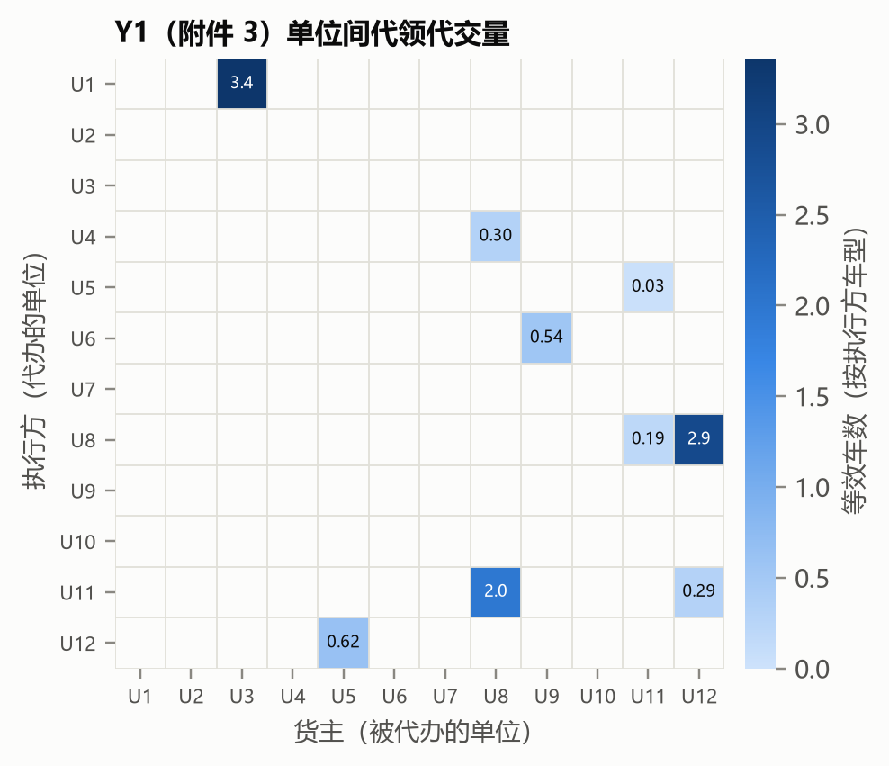

# 六、问题 1：Y1 统筹方案的形成与评估

## 6.1 需求块追溯

把附件 2 拆成 67 个需求块，逐块到附件 3 中找执行它的批次。匹配按“外部仓库、方向、货物、数量”进行，先配同单位自办，再配跨单位代办；内部互转的“领”型块还允许以“反转为代交”的形式被发货方执行。附件 2、3 的批次号只是顺序号（录 4.2），不能直接对应，因此每个附件 3 批次以其自有货物的来源确定对应的附件 2 原批次。

**结果。** 67 块全部追溯成功，附件 3 没有多余货量：

- 51 块由本单位自办；
- 16 块跨单位转移，其中代领 14 块、代交 1 块、内部互转反转为代交 1 块。

每一笔转移都能归入题设的情形：代领① 11 笔、代领⑤ 2 笔、代领② 1 笔、代交① 1 笔、代交② 1 笔。没有一笔需要题设以外的情形。这说明附件 3 的统筹是按“就近就便”规则逐块做出的，而不是整批合并。

**统筹是怎样形成的。** 32 个批次减为 27 个：消掉的 5 个批次，货物全部由去同一仓库的其他单位顺带，没有同一单位的批次之间合并（符合录 2.10）。16 笔转移中 12 笔发生在共用存放仓库的单位之间（代领① 11 笔、代交① 1 笔），这是最直接的合并方式；不共用仓库的只有 4 笔（代领⑤ 2、代领② 1、代交② 1）。

【表 6-1 16 笔转移清单（货主、执行方、仓库、情形、等效车数）——由 results/F/p1/trace.csv 生成】

图 6-1 Y1（附件 3）单位间代领代交量（行为执行方，列为货主，按执行方车型的等效车数）

## 6.2 评价指标

从统筹效果和实施风险两方面定义指标（录 1.一.1(3)）：

| 类别 | 指标 | 定义 |
|---|---|---|
| 效果 | 批次数、运力、总车数、总人数 | 统一口径（5.3 节） |
| 效果 | 批次-仓库对 | Σ_β \|W_β\| |
| 效果 | 调运总里程、载货车辆总行驶距离 | Σ D_β、Σ L̄_β，路线按表中仓库顺序（录 4.3） |
| 效果 | 代领代交量 A、失衡度 E | 见 9.1 节 |
| 风险 | 越窗批次数、开始偏离 | 实施开始日不在 [a − 6, e] 内的批次数；Σ\|开始日 − a\| |
| 风险 | 天数不足批次数 | 表列实施天数 < 按表执行所需天数（时间引擎回放）的批次数 |
| 风险 | 超载批次数、超 2000 km 批次数 | 按表中顺序行驶时车上装载量超过运力；总里程 > 2000 km |

## 6.3 统筹前后对比

统筹前按附件 2，每批全部自办、按提报开始日出发；统筹后按附件 3 的指派和实施开始日。两者都按表中仓库顺序、统一行动、由时间引擎回放。

| 指标 | 统筹前 | 统筹后 | 变化 |
|---|---:|---:|---:|
| 批次数 | 32 | 27 | −5 |
| 运力（辆） | 284 | 280 | −4 |
| 总车数（辆，原表口径） | 363 | 374 | +11 |
| **总车数（辆，统一口径）** | **392** | **374** | **−18** |
| 总人数（人，统一口径） | 1020 | 963 | −57 |
| 批次-仓库对 | 59 | 45 | −14 |
| 调运总里程（km） | 32489 | 25513 | −21.5% |
| 载货车辆总行驶距离（km） | 16944.6 | 13477.9 | −20.5% |
| 代领代交量（等效车） | 0 | 10.206 | — |
| 失衡度 E | — | 0.692 | — |
| 回放所需执行总天数 | 131 | 111 | −20 |

<!-- P1.before/after.* ；原表口径 363→374 来自 R1 -->

按原表数字，统筹后的车数反而多了 11 辆。原因是附件 2 的备用车按向下取整计，附件 3 按向上取整计；按同一口径，统筹实际节省了 18 辆车、57 人。

## 6.4 实施风险

1. **时间窗。** 27 批中有 **16 批的实施开始日不在规则允许的范围内**，其中 14 批晚于提报结束日；开始偏离合计 251 天。换用另两种时间窗读法（“早于 7 天以上”含第 7 天；按被合并各原批次时间窗的并集），越窗批次数仍为 16；若不允许提前出发则为 18。
2. **天数不足。** 附件 3 的表列实施天数合计 104 天，而按表执行至少需要 111 天。**11 批的表列天数少于按表执行所需的天数**，其中 1 批的不足来自与其他批次在同一仓库排队。即使允许任意调整路线，仍有 5 批做不到；即使再放宽为“途中可以过夜”，仍有 3 批做不到。其中附件 3 第 7 批（U10）只用装卸就需 22.4 小时，超过两天的 16 小时工时，与路线无关。
3. **天数没有重新核算。** 这个问题在提报阶段就已存在：附件 2 的提报时长合计 122 天，按表执行至少需要 131 天，有 15 批的提报时长短于所需天数。附件 3 中 **19 批的实施天数恰好等于附件 2 对应批次的提报时长**，而只有 9 批的实施开始日等于提报开始日。按任意路线也做不到的 5 批全部属于这 19 批，按表中顺序做不到的 11 批中有 9 批属于这 19 批。可见业务人员挪动了实施日期，但没有按合并后的任务重新核算天数。
4. **装载。** 附件 3 第 19 批（U4）按表中顺序先到 WF 再到 WS，到 WF 装完时车上 12.41 等效车，超过运力 12 辆；换成先 WS 后 WF，里程同为 900 km，不超载。
5. **里程。** 统筹前有 1 批按表中顺序行驶 2103 km，超过“一般不超过 2000 km”；统筹后最长 1832 km。

## 6.5 与模型最优的差距

把问题 2 的整数规划（含每批存在 ≤ 2000 km 合规路线的检查）用于附件 2，在与问题 2 相同的口径下（不考虑实施时间），Y1 最少可统筹为 **23 批**（禁用代领④时为 25 批），比人工方案少 4 批。人工方案的 27 批在批次数上还有改进空间；这 23 批是否都能排出满足时间规则的实施方案，本文没有验证。

## 6.6 小结

附件 3 的统筹逐块遵循了题设的就近就便情形，按统一口径节省了 5 个批次、18 辆车、57 人和约五分之一的里程。它的主要风险在时间：多数批次的实施日期偏离了提报时段，而实施天数基本沿用提报时长、没有随合并后的任务重新核算，导致 11 批的计划天数不够用。
