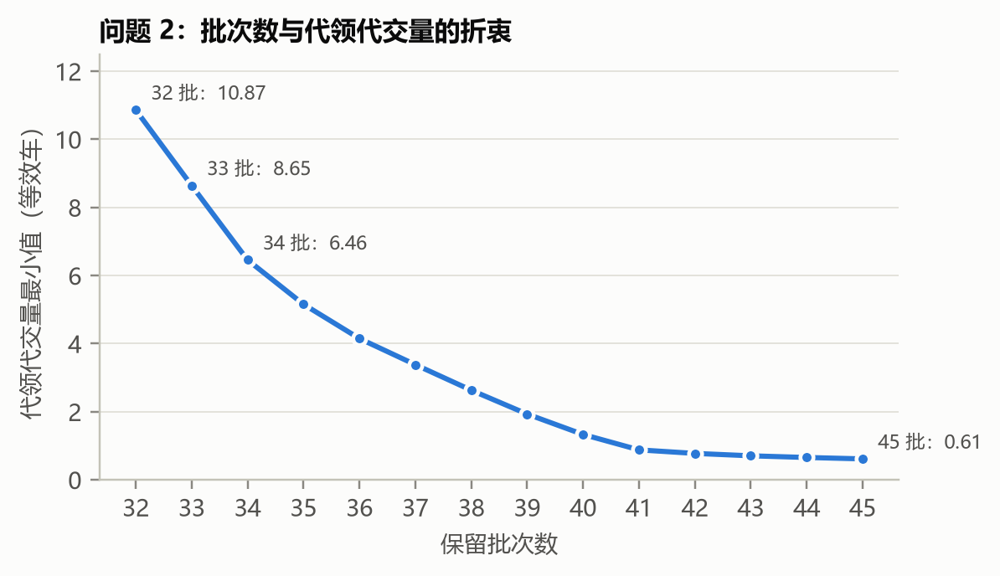

# 七、问题 2：需求块指派的字典序整数规划

## 7.1 转移选项

对每个需求块 k（货主 y）和另一单位 x 的每个原始批次 β，按题设情形生成转移选项。记 $W_\beta^{own}$ 为 β 保留的自有块所到的目标仓库（假设 H6）。

**表 7-1 就便情形的判定条件**（代领：货在 w_k，要到 h_k；代交：货在 h_k，要到 w_k；都要求 $w_k\in W_\beta^{own}$）

| 情形 | 条件 | 执行方把货卸在 / 从哪装 |
|---|---|---|
| 代领① | h_k ∈ H(x)（共用存放仓库） | 卸在 h_k |
| 代领② | h_k ∉ H(x)，h_k ∈ W_β^own | 路过 h_k 时卸下 |
| 代领③ | h_k ∉ H(x) ∪ W_β^own，β 本来要去卸自有货的 h_x ∈ H(x) 距 y 的驻地 ≤ 150 km | 卸在 h_x，货主自取 |
| 代领④ | 同上但不要求 150 km；h_x ∈ W_β′^own，β′ 是 y 的某个批次，且 β′ 整批在 β 之后（假设 H12） | 暂存 h_x，β′ 到此领回 |
| 代领⑤ | h_k ∉ H(x) ∪ W_β^own，d(x 驻地, h_k) ≤ 150，且 β 同时为 y 从同一 h_k 代交 | 先到 h_k 装代交货，再到 w_k 代领，送回 h_k |
| 代交① | h_k ∈ H(x) | 从 h_k 装 |
| 代交② | h_k ∉ H(x)，d(x 驻地, h_k) ≤ 150 | 专程到 h_k 装（不计入目标仓库） |
| 代交③ | h_k ∉ H(x)，h_k ∈ W_β^own | 路上先到 h_k 装 |

**“就近”的读法。** 录 2.5 先定义“就近”（双方共用队属仓库，或任一方驻地到另一方可用队属仓库 ≤ 150 km），再列出“就便”的 5 + 3 种情形，其中代领③⑤、代交②各自写明了 150 km 条件。本文按“满足所列情形之一即可”处理，不对每笔代办另加“就近”。依据是题目给出的统筹实例：附件 3 的 16 笔跨单位转移中，有 2 笔不满足“就近”（U4 代领 U8 在 WF 的货、U12 替 U5 在 WO 的转移），出题方自己的统筹计划并未要求每笔都“就近”。若对每笔代办另加“就近”，问题 2 的最少批次由 32 变为 34（477 辆、1224 人，gap = 0），作为对照报出。<!-- X.d2b.* -->

**“共用”的口径。** U7（WQ、WU）和 U11（WO、WS）各有两个可用队属仓库，附件 4 的备注为每笔货指定了存放仓库。本文按该笔货指定的存放仓库判定是否与执行方“共用”：例如 U3 与 U7 共用 WQ，但 U7 的某块货指定存放在 WU，对这块货而言二者不共用。附件 3 的官方统筹即如此区分——U8 替 U11 代领的货存放 WO，U5 替 U11 代领的货存放 WS。

此外，“领”型内部互转块（收方到发方的队属仓库取货）可以改写为“交”型块，由发方顺带送去。U9 的块只能由 U9 自己或 U6 执行（录 2.6）。Y2 的 90 个块共生成 197 个转移选项。

## 7.2 模型

决策变量：$z_{k,o}\in\{0,1\}$ 表示块 k 取选项 o（含“自办”）；$y_\beta\in\{0,1\}$ 表示原批次 β 保留。

**约束：**

1. 每块恰取一个选项：$\sum_o z_{k,o}=1$。
2. 批次保留当且仅当它至少保留一个自有块；转入批次 β 的选项只在 β 保留时可取。
3. 情形依据：选项所依赖的 $W_\beta^{own}$ 中的仓库，必须由 β 保留的某个自有块提供。
4. 目标仓库数：$|W_\beta|\le 4$（录 2.1）；目标仓库数不增加（录 2.4）由情形依据自动保证。
5. 增车：$T_\beta-T_\beta^0\le 3$，且 $T_\beta\le 30$（录 2.2、3.5）。T 的取整用整数辅助变量线性化。
6. 代领④的静态必要条件：β 的最早出发日不晚于 β′ 的最晚出发日。真实先后在问题 3 排程时检查。
7. 里程：求解后为每个保留批次枚举路线，检查存在 ≤ 2000 km 的合规路线；不存在则对该批次的转入组合加割重解。

**目标（字典序，假设 H14）：** ① U9 交给 U6 的块数最多（录 2.6）；② 保留批次数最少；③ 代领代交量 A 最少；④ 提报时段不相容的（被代原批次, 执行批次）对数 V⁰ 最少。每一级求到最优后把目标值固定为约束，再求下一级。四级之后若仍有并列，取 ⑤ 使问题 3 合成目标最小的指派（7.3 节）。

## 7.3 结果

Gurobi 13.0 求解，四级均达到最优（gap = 0）；里程检查一次通过，没有加割。第二方用 CP-SAT 独立建模（目标仓库只由最终保留的自有块提供依据），四级目标值相同。

**附表 2 问题 2 结果**

| 指标 | 结果 |
|---|---:|
| 调运总批次（批） | **32** |
| 调运总车数（辆） | **473** |
| 出动总人数（人） | **1210** |
| 代领代交货物总量的等效车数（辆） | **10.868** |

<!-- P2.main.B/N/P/A -->

- 46 批中消掉 14 批。U2 的 3 个批次全部被顺带（U5 代办 4 块、U8 代办 1 块），U2 在 Y2 不再出动；U9 的 3 个批次中，批 35 的货全部交给 U6，批 36、37 各只剩一块 U6 无法承接的货（去 WD、WJ）。
- 25 个块跨单位转移：代领① 13、代领② 5、代领④ 2、代领③ 1、代领⑤ 1、代交① 1、代交② 1、代交③ 1。
- U9 的 7 个块中 5 个交给 U6；另 2 个在 WD、WJ，U6 的任何批次都不去这两个仓库，无法承接。
- 批次-仓库对由 73 降至 51，失衡度 0.703，V⁰ = 8。

**最优解不唯一，第 5 级由问题 3 决定。** 四级目标值全部固定后，对块指派逐个加排除割继续求解，又找到 2 个同样最优的指派，此后无解，说明恰有 3 个（代办量按精确有理数相等）。第二方用独立的精确有理数 CP-SAT 模型同样逐个加割枚举，也恰得 3 个，90 块的去向逐块一致，并为每个指派的每一批构造了 ≤ 2000 km 的合规路线。三者只在一块货上不同：U4 在 WG 的代领④块，分别由 U6 的批 13 暂存 WP、批 25 领回（指派 0，求解器最先给出的解），U12 的批 43 暂存 WO、批 28 领回（指派 1），U5 的批 8 暂存 WS、批 27 领回（指派 2）。三者在问题 2 的四级目标上无从区分，但对问题 3 影响很大：在指派 0 下，批 13 至少占 6 个自然日、而批 25 只比它晚 1 天提报，开始偏离至少 5 天（8.4 节给出证明）；另两个指派把这笔货交给提报时间相隔数周的批次，偏离可以接近 0。因此本文把“问题 3 合成目标最小”作为第 5 级（假设 H14），三个指派用同一把标尺比较（8.2 节），选中指派 2：车 473、人 1210，比指派 0 各少 1 辆、2 人；失衡度 0.703，比指派 0（0.651）略高。三个指派都经独立检查器核验。<!-- P2.ties.n P2.tie*.N/P/E；内部：f_run_p2.py → p2/ties.csv；evidence V38、R43 -->

## 7.4 折衷曲线与对照

把批次数固定为 32–45，逐一求代领代交量的最小值：

图 7-1 批次数与代领代交量最小值的折衷曲线<!-- P2.curve.* -->

曲线前陡后缓：从 33 批减到 32 批要多代办 2.2 等效车，而从 45 批（受 U9 条款约束，最多保留 45 批）减到 40 批只需多代办 0.7 等效车。

| 方案 | 最少批次 |
|---|---:|
| 主方案 | 32 |
| 禁用代领④ | 33 |
| 只允许共用队属仓库的代办（代领①、代交①） | 37 |
| U9 条款按字面读法（U9 保留的块不存在交给 U6 的可能即可） | 31 |
| 150 km 阈值取 149 km | 32 |
| 禁用内部互转反转 | 32 |
| 要求代办双方的提报时段相容（V⁰ = 0 优先） | 37 |

代领④和 U9 条款的读法各影响 1 个批次；“只用共用仓库”这一简单强基线要 37 批，说明非共用情形贡献了 5 个批次的减少。

## 7.5 小结

问题 2 的指派在题设规则下精确求解：Y2 最少 32 批，第二方独立模型确认。四级目标下有 3 个并列最优指派，它们对问题 3 的偏离影响很大，本文按问题 3 的合成目标从中选择。批次数与代领代交量的折衷曲线前陡后缓，若业务部门更看重代办量，保留 33–34 批即可把代办量降到 6.5–8.6 等效车。
