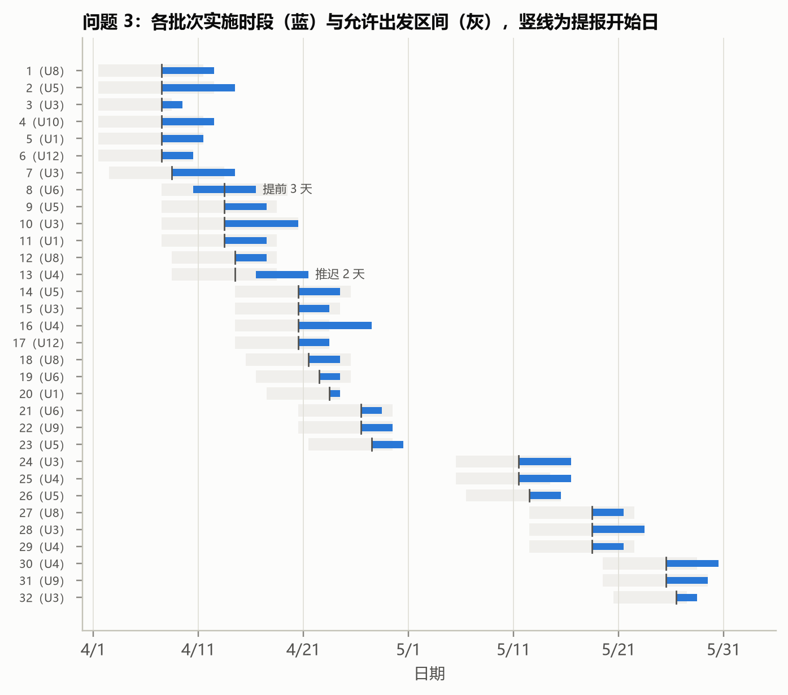
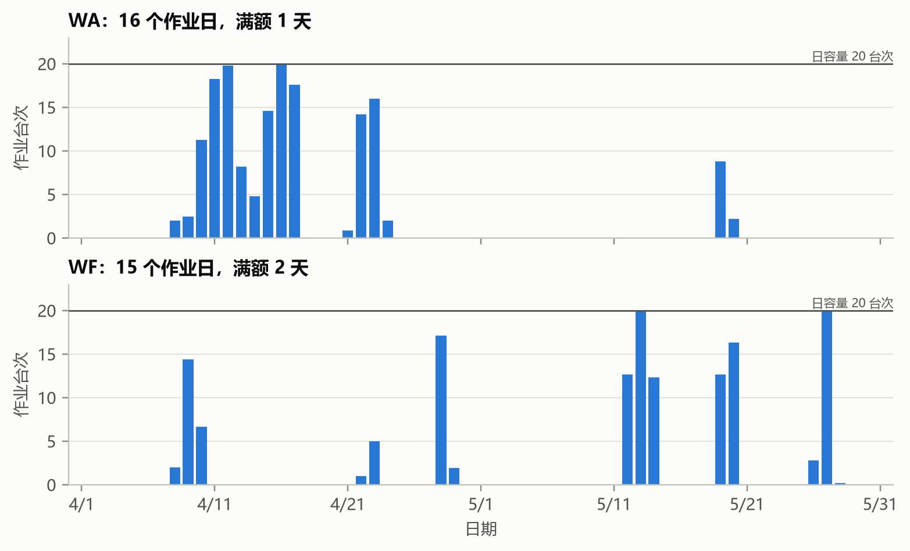

# 八、问题 3：路线枚举与事件回放排程

## 8.1 批内路线枚举

固定问题 2 的指派后，每个批次要处理的货按“（装车地点，卸车地点）”分成若干货组。用深度优先搜索枚举该批次的全部合规路线。每一步选择下一站，在该站决定卸哪些货、装哪些货、是否把已装车的车留置在此。路线须满足：

1. 从驻地空车出发、回到驻地；从自己队属仓库装车送往外面的上交货（含替别人代交的货）在到访任何外部仓库作业之前装车；接领的货最后才卸进自己的队属仓库（录 1.一.3；件 7 注 2）；
2. 代领⑤先到 h_k 装代交货，再到 w_k 代领；
3. 留置的车必须回到原站汇合，多站留置按相反顺序汇合（录 1.一.1(2)）；留置车从留置到车队回来重新开工之间整天闲置不超过 1 天（录 3.4“最多在目标货物仓库等待 1 天”）；
4. 行驶车队的等效装载量不超过它的车数（留置时扣减留下的车）；
5. 只经过本批次自己的站点，同一站最多到访 2 次（假设 H10）；总里程 ≤ 2000 km。

每条路线用时间引擎单独回放，得到占用天数、载货平均距离、里程。32 批共 535 条合规路线，每批 1–173 条，全部保留为候选：单独回放时被支配的路线（例如天数、载货距离相同而里程更长），在与其他批次排队时可能因到站顺序不同而错开冲突，不能事先删去。

**命题 1（留置等价于后到）。** 对任一批次，若一条路线在站 w 装上货组 G 后把这些车留置，之后回到 w 汇合，那么把它改写为“第一次到 w 时不装 G，回到 w 时再装 G”，得到的新路线中每个货组的载货距离与原路线逐组相等。

*证明。* 留置期间 G 所在的车停在 w，不累计距离；汇合后 G 随车队从 w 走完剩余路线。改写后 G 在回到 w 时才装车，之后同样随车队走完相同的剩余路线。其他货组所在的行驶车队，走过的路径在两条路线中完全相同。因此每组的 $L_i$ 不变，$s_i$ 也不变，$\bar L$ 相等。∎

命题说明留置不能降低载货距离；它的作用在时间上：第一次到站时就把货装完，回来时不必再排队装货。数值核对：32 批中有 13 批存在含留置的路线，每一批的“不含留置的最小载货距离”都正好等于“含留置的最小载货距离”。关闭留置后执行总时间多 1 天（表 8-2）。

## 8.2 批间排程

方案由每批的（候选路线, 出发日）组成。出发日取值 $[a_\beta-6,\ e_\beta]$（录 2.8）。整套方案用时间引擎**一起回放**：各批在同一仓库按到达先后排队、共享日容量；回放后检查同单位同日在执行批次 ≤ 2（录 2.9）、等待 ≤ 1 天、代领④整批先后。

**合成目标。** 三个目标量纲不同，按下界 $l_i$ 与规则基线 $u_i$ 归一化后等权相加：

$$Z=\sum_{i\in\{\tau,\bar L,\delta\}}\frac{f_i-l_i}{u_i-l_i},$$

并列时取被代方时段不相容对数 V 小者，再并列取调运总里程小者。

**算法。**

1. 起点：每批取里程最短的候选、按提报开始日出发（即规则基线）；
2. 坐标下降：依次对每个批次，在其全部（路线, 出发日）组合中取使整套方案 Z 最小且可行者，直到一轮无改进；
3. 成对邻域：对共用仓库、同单位或由代领④相连的批次对，联合枚举两批的组合（路线只取单独回放时在天数、载货距离、里程上不被支配的子集，32 批共 61 条），直到无改进；
4. 多起点：开始偏离取到最小值的出发日组合只有 4 种（见 8.3），对每种固定出发日、随机取 30 组路线作起点，再做只换路线的坐标下降；
5. 收尾：在全部（路线, 出发日）上再做一轮坐标下降，按（Z, V, 总里程）比较。

**下界。** 任一批与其他批次一起回放时，到达每一站的时刻都不早于它单独回放的时刻（排队只会推迟；行驶、装卸规则对出发时刻单调），载货距离只由路线决定。因此各批孤立执行的最少天数之和、最小载货距离之和分别是 Σ τ 和 Σ L̄ 的下界（在本文的时间规则读法和“每站最多到访 2 次”的路线空间内成立；换一种时间规则读法，天数可以更少，见第十章）；把各批孤立的（天数, 载货距离, 偏离）代入 Z，再加上同单位同日 ≤ 2 批与代领④整批先后，求最小 Z 的整数规划，得到 Z 的下界。

## 8.3 结果

**附表 3 问题 3 结果**

| 指标 | 结果 |
|---|---:|
| 人员调动执行总时间（天） | **126** |
| 实施开始时间偏离提报开始时间总天数（天） | **5** |
| 调运总里程（公里） | **29719** |
| 载货车辆总行驶距离（公里） | **12604.1** |

<!-- P3.main.tau/delta/D/L -->

**表 8-1 下界、规则基线与本文方法**

| | 执行总时间（天） | 载货距离（km） | 开始偏离（天） |
|---|---:|---:|---:|
| 下界（各批孤立最优之和） | 124 | 12566.2 | 0（孤立）/ **5（考虑代领④，见下）** |
| 规则基线 | 134 | 14412.9 | 5 |
| **本文方法** | **126** | **12604.1** | **5** |
| 相对基线 | −6.0% | −12.6% | 持平 |
| 距下界 | +2（1.6%） | +37.8（0.30%） | 达到下界 |

<!-- P3.lb.* P3.base.* P3.main.* -->

32 批中 26 批同时达到了各自的孤立最少天数和最小载货距离。剩下的差距有三个来源：批 7 多用 1 天换来载货距离少 683.7 km（这是折衷，不是损失）；批 27 在 WF 排队，多 1 天；载货距离共多 37.8 km，其中批 13 为满足代领④的先后走 6 天的路线，多 33.5 km；批 1、30、32 为少用天数选了载货距离略长的路线，共多 4.3 km。

合成目标的下界为 Z ≥ 1.120，本文方法 Z = 1.220，相差 0.1，约合 1 天执行总时间。进一步按开始偏离分情形枚举可知：比本文更好的方案若存在，开始偏离必须恰为 5 天、出发日只能是 4 种组合之一，且执行总时间 ≤ 125 天，或为 126 天而载货距离更短。剩余情形每种约 5.8 亿个路线组合，没有穷举完，所以本文不声称最优。【单方结果，待第二方复核】

**开始偏离 5 天是下界。** 唯一一笔不可避免的偏离来自代领④：U6 的批 13（提报 4 月 14 日起）替 U4 代领一块货，暂存在 WP，由 U4 的批 25（提报 4 月 15–18 日）领回。批 13 要到 WA、WG 两个仓库，装卸至少 58 台次（出发时在 WP 装送交货 ≥ 10、WA 卸装 ≥ 28、WG 装 ≥ 1、返程在 WP 卸 ≥ 19）：最短闭合路线 1067 km，至少行驶 17.07 小时；装卸至少 23.2 小时；合计 40.27 小时，超过 5 个工作日的 40 小时，所以至少占 6 个自然日。设两批出发日为 x、y，整批先后要求 y − x ≥ 6，而两个提报开始日只差 1 天，故 $|x-14|+|y-15|\ge 5$。本文方案取 x = 10、y = 16，正好取等。同一论证说明：**在问题 2 的指派下，如果所有批次都不早于提报开始日出发，问题 3 没有可行方案**（问题 4 改变了这笔代领④的去向，偏离可以为 0，见 9.3 节）（批 13 最早 4 月 19 日回驻地，批 25 最晚 4 月 18 日必须出发）。这一论证由第二方独立给出。

**路线特征。** 18 个批次的路线重复经过了本批次的站点（途经），1 个批次使用了留置。到达外部仓库共 62 次，批次-仓库对 51 个。

图 8-1 问题 3 各批次实施时段（蓝）与允许出发区间（灰），竖线为提报开始日；批号为附件 7 中的编号

图 8-2 作业量最大的两个仓库的日作业台次

## 8.4 消融与合成方式

**表 8-2 消融（同一指派、同一合成目标）**

| 方案 | 执行总时间 | 载货距离 | 开始偏离 |
|---|---:|---:|---:|
| 本文方法 | 127 | 12602.5 | 5 |
| 关闭留置 | 128 | 12604.1 | 5 |
| 关闭途经（每段只走直达） | 130 | 13293.2 | 5 |
| 留置、途经都关闭 | 133 | 13294.8 | 5 |
| 不允许提前出发 | 不可行 | — | — |

<!-- X.ablation.* -->

途经贡献最大：关闭后载货距离多 690.7 km（5.5%）、天数多 3 天，原因是距离矩阵不满足三角不等式。留置只影响天数（多 1 天），与命题 1 一致。提前出发是必需的。

**表 8-3 合成方式**

| 合成方式 | 执行总时间 | 载货距离 | 开始偏离 |
|---|---:|---:|---:|
| 等权和（主结果） | 127 | 12602.5 | 5 |
| 先比最差的一项 | 130 | 12602.5 | 5 |
| 权重 0.4 / 0.4 / 0.2 | 126 | 12602.5 | 8 |

载货距离对合成方式不敏感；天数与偏离之间存在此消彼长。

## 8.5 小结

问题 3 在固定指派下把执行总时间压到 126 天、载货距离压到 12604.1 km，距各自下界分别为 1.6% 和 0.30%（下界在“每站最多到访 2 次”的路线空间内成立）；开始偏离 5 天已达到下界。本文不把 126 天称为最优：合成目标距下界 0.1（约 1 天），且已把可能更好的方案限定在 4 种出发日组合之内。
