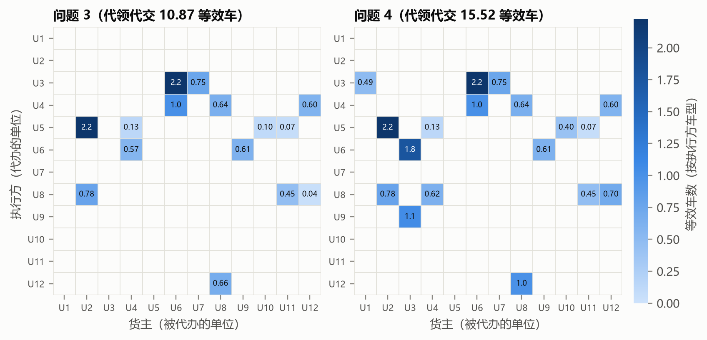

# 九、问题 4：指派与排程的联合邻域搜索

## 9.1 均衡性指标

记 $H_u$ 为单位 u 替别人执行的代领代交量，$R_u$ 为别人替 u 执行的量（都按执行方车型的等效车数），$A=\sum_u H_u=\sum_u R_u$。定义**失衡度**

$$E=\frac{\sum_u |H_u-R_u|}{2A}\in[0,1]\quad(A=0\text{ 时 }E=0).$$

E = 0 表示每个单位帮出的量与受助的量相等，正是录 2.7“帮助其他单位的同时也有其他单位帮助他们”的含义；E = 1 表示帮与被帮完全分属两拨单位。分母取 2A，使 E 不随代办总量的规模变化。正文另附单位间的代领代交流量矩阵（图 9-1）。

## 9.2 模型

决策与问题 2、3 相同：每块的去向、每批的路线和出发日。约束为问题 2 的全部指派约束加问题 3 的全部路线与排程约束。批次数固定为问题 3 的 32 批（另做 33、34 批的对照，9.4 节）。

**合成目标。** 五项区间归一化后等权相加：执行总时间、载货距离、开始偏离沿用问题 3 的标尺（下界 / 规则基线）；失衡度以 0 和问题 3 方案的值为两端；批次-仓库对以 32 批下的最小值 42（整数规划求得）和问题 3 方案的 51 为两端。

**算法（单块改派邻域搜索）。**

1. 起点两个：问题 3 的方案；32 批下批次-仓库对最少的整数规划解（先排程）。
2. 每一遍按随机顺序扫描 90 个块。对每个块，尝试把它改派到另一个合法去向（含改回自办），先检查全部指派约束，再只对受影响的批次重选（路线, 出发日），其余批次不动；在全部改派中取合成分下降最多的一个接受。
3. 一遍无改进即停。两个起点各用 6 个随机种子，共 12 次，取合成分最小者，最后对全部批次再做一次坐标下降。

## 9.3 结果

**附表 4 问题 4 结果**

| 指标 | 结果 |
|---|---:|
| 调运总批次（批） | **32** |
| 调运总车数（辆） | **473** |
| 出动总人数（人） | **1210** |
| 代领代交货物总量的等效车数（辆） | **15.515** |
| 人员调动执行总时间（天） | **127** |
| 实施开始时间偏离提报开始时间总天数（天） | **0** |
| 调运总里程（公里） | **29499** |
| 载货车辆总行驶距离（公里） | **12470.8** |
| 均衡性指标（失衡度 E） | **0.408** |
| “批次-仓库对”数量（个） | **46** |

<!-- P4.main.* -->

**表 9-1 与问题 3 方案的比较**

| 指标 | 问题 3 | 问题 4 | 变化 |
|---|---:|---:|---:|
| 批次-仓库对 | 51 | 46 | −5（−9.8%） |
| 失衡度 E | 0.651 | 0.408 | −0.243（−37.3%） |
| 载货车辆总行驶距离（km） | 12602.5 | 12470.8 | −131.7（−1.0%） |
| 开始偏离（天） | 5 | 0 | −5 |
| 执行总时间（天） | 127 | 127 | 0 |
| 调运总车数 / 出动总人数 | 474 / 1212 | 473 / 1210 | −1 / −2 |
| 调运总里程（km） | 29803 | 29499 | −304 |
| 车公里（辅助） | 139658 | 137734 | −1.4% |
| 外部仓库到达总次数 | 63 | 57 | −6 |
| **代领代交量（等效车）** | **10.868** | **15.515** | **+4.647（+42.8%）** |
| 被代方时段不相容对数 V | 11 | 17 | +6 |

问题 4 在批次-仓库对、失衡度、载货距离、开始偏离四项上优于问题 3，执行总时间持平；代价是代领代交量增加约 43%，被代方时段不相容的对数也增加。代办块由 25 个增至 35 个，其中 11 个块的去向与问题 3 不同。

**偏离为什么能降到 0。** 问题 3 的 5 天偏离来自问题 2 指派中的一笔代领④（8.3 节）。问题 4 改变了这笔货的去向：U4 在 WG 的那块货改由 U8 的批 3 代领、暂存在 WO（4 月 24 日回驻地），由 U4 的批 28 于 5 月 19 日领回；另一笔代领④仍由 U5 的批 7 暂存在 WS（4 月 14 日回驻地），由 U4 的批 27 于 5 月 12 日领回。两笔的暂存批次与领回批次都相隔数周，整批先后不再与时间窗冲突。

**辅助指标“车公里”。** 载货距离是各批平均值之和，代办量增加会改变各批的权重。为排除这种“指标效应”，另计 $\sum_\beta\sum_i s_iL_i$（车公里）：问题 4 也减少 1.4%，说明载货距离的下降是真实的运输量下降。

**代领③的隐性成本。** 代领③中货主自取的行程不计入任何批次（假设 H11）。问题 4 用了 5 次代领③（问题 3 为 1 次），自取 5.013 等效车，三个货主—仓库对的往返合计 772 km。禁用代领③后，问题 2 的最少批次变为 33，问题 4（33 批）为 129 天 / 12343.0 km / 偏离 0 / E = 0.396 / 仓库对 48。

图 9-1 问题 3（左）与问题 4（右）的单位间代领代交量，同一色标

## 9.4 批次数的折衷

| 批次数 | 执行总时间 | 载货距离 | 开始偏离 | 失衡度 | 仓库对 | 代领代交量 |
|---:|---:|---:|---:|---:|---:|---:|
| 31 | 不可行（问题 2 已证最少 32 批） | | | | | |
| **32** | **127** | **12470.8** | **0** | **0.408** | **46** | **15.515** |
| 33 | 131 | 12713.2 | 0 | 0.390 | 47 | 18.337 |
| 34 | 132 | 12844.7 | 0 | 0.266 | 48 | 17.835 |

<!-- X.p4b.* -->

多保留批次只能进一步降低失衡度，其余指标全部变差。业务上若更看重均衡，可以保留 34 批，以多 5 天、多 374 km 载货距离换取失衡度由 0.408 降到 0.266。

## 9.5 搜索的稳定性

12 次搜索终点的合成分在 1.42–1.65 之间，从问题 3 方案出发的 6 次终点各不相同，从仓库对最少解出发的 6 次几乎相同。最终方案经全局坐标下降收尾后为 1.319。可见搜索对起始顺序敏感，结果是局部最优；本文只声称“找到了一个在四项指标上优于问题 3、执行总时间持平的可行方案”，不声称最优。

## 9.6 小结

联合优化指派与排程后，批次-仓库对减少 5 个、失衡度下降 37%、偏离降为 0、载货距离略降，执行总时间不变，代价是代办量增加 43%。目标仓库数和均衡性的改善，主要来自把货转给本来就要去那些仓库、且帮与被帮更对等的单位。
