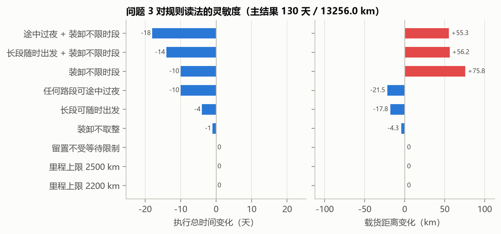

# 十、灵敏度分析

对 13 处有解释空间的规则，各换一种读法重算，其余不变。问题 3 的数字都在问题 2 的同一指派下用同一算法得到。

**表 10-1 口径灵敏度**

| # | 规则（主读法 → 备选读法） | 影响 |
|---|---|---|
| 1 | U9 条款：凡能交给 U6 的都交 → U9 保留的块不存在交给 U6 的可能即可 | 问题 2：32 → 31 批 |
| 2 | 问题 2 不看时间 → 要求代办双方的提报时段相容 | 问题 2：32 → 37 批，代办量 10.868 → 6.414；该指派下问题 3 为 148 天 / 15228.8 km / 偏离 0 |
| 3 | 保障车 T ≥ 21 取 2 台 → T ≥ 26 取 2 台 | 问题 2：474 → 471 辆、1212 → 1206 人；问题 4：474 → 471 辆、1214 → 1208 人 |
| 4 | 单批里程 ≤ 2000 km → ≤ 2200 / 2500 km | 不变（主方案里程约束不起作用） |
| 5 | 150 km 阈值 → 149 km | 问题 2 不变 |
| 6 | > 500 km 的路段只在 8:00 出发 → 随时出发、途中过夜 | 问题 3：123 天 / 13417.3 km / 偏离 5 |
| 7 | 当天到不了下一站就次日出发 → 任何路段都可随时出发、途中过夜 | 问题 3：116 天 / 13260.9 km / 偏离 8 |
| 8 | 装卸只在 8:00–16:00 → 可连续做到夜间（录 3.9“不考虑仓库的工作时段”） | 问题 3：119 天 / 13370.6 km / 偏离 5 |
| 9 | 装、卸分别向上取整 → 不取整 | 问题 3：127 天 / 13290.5 km / 偏离 5 |
| 10 | 留置的车也受“等待 ≤ 1 天”限制 → 不受限 | 不变 |
| 11 | 同一作业站可到访 2 次 → 每个外部仓库只到访一次 | 问题 2 的指派不可执行：批 18、25 无合规路线。批 18 用了代领⑤，要先在 h_k 装代交货、代领后再回 h_k 卸货；批 25 在 WP 先装代交货去 WE（代交③），回来后在 WP 卸代领货（代领②）。两批都必须两次到访同一外部仓库 |
| 12 | 每段里程取附件 1 表列值 → 可经本批次的站点（含驻地）中转，取中转后更短的里程（裁决 X1 的反面） | 问题 3：126 天 / 12604.1 km / 偏离 5 |
| 13 | 代领代交只需满足所列情形之一 → 每笔另须“就近”（裁决 D2 的反面） | 问题 2：32 → 34 批，474 → 477 辆、1212 → 1224 人 |

<!-- X.rules.* ；sens.csv；p3_ablation.csv（借道）；X.d2b.* -->

另外两种组合：读法 6 + 8 为 114 天 / 13337.1 km，读法 7 + 8 为 110 天 / 13336.2 km。代领③禁用（假设 H11 的反面）时问题 2 为 33 批。

图 10-1 问题 3 对规则读法的灵敏度（同一指派；蓝为减少，红为增加）

**结论。**

1. **载货距离对时间规则稳健**：各种时间读法下在 13261–13417 km 之间，与主结果相差不到 1%。
2. **执行总时间不稳健**：110–129 天，取决于“当天到不了下一站能否先走一段”和“装卸能否做到夜间”。本文按录 3.2、3.4 的字面（装卸计入每天 8 小时；到不了就次日机动）取 129 天。是否允许借道驻地也影响 3 天、690.7 km（读法 12）。
3. **批次数对 U9 条款、代领④、代领③、“就近”和时段相容的读法敏感**：分别为 31、33（禁用代领④）、33（禁用代领③）、34、37 批，主读法为 32 批。
4. **问题 4 与问题 3 的取舍随读法变化**：在“任何路段可途中过夜”的读法下，问题 4 为 114 天 / 13295.7 km / 偏离 4 / 仓库对 44，问题 3 为 116 天 / 13260.9 km / 偏离 8 / 仓库对 51，问题 4 的天数、偏离、失衡度、仓库对更好，载货距离多 34.8 km；主读法下则是天数多 1 天、载货距离少 383.7 km。

# 十一、模型检验与评价

## 11.1 检验汇总

| 检验 | 结果 |
|---|---|
| 公式复现 | 运力、人数公式在三张附件表的 105 个批次上全部等于表列值 |
| 解析守恒 | 附件 2、3 货物总量相等（5,971,074），逐货号相等；附件 4 总量 10,727,184 |
| 时间引擎 | 5 个手算例与第二方算例全部一致 |
| 约束残差 | 附件 6、7、8 在独立检查器下违例 0 条，附表 2–4 的指标逐项复现 |
| 检查器自检 | 10 种篡改（时刻、货量、整批推迟、代领改自领、无关节点、留置超时、删去暂存备注、领回量不符、代交改记他人、部分留置）全部按预期检出或不误报 |
| 第二方复算 | 问题 2：独立的 CP-SAT 模型得到相同的四级目标与 90 块指派；问题 3、4：第二方独立实现逐站回放，对规则修订前的版本（允许途经）580 个到离时刻全部吻合、S1–S16 与 R1–R8 逐条通过，并独立证明了问题 3 开始偏离的下界；现行版本（直达、字面留置）下，第二方对问题 3、4 结果表逐站回放 480 个到离时刻，误差均在半分钟舍入内，硬约束 0 违例，附表 3、4 全部指标一致，并独立证明问题 3 方案按 (Z, V, 总里程) 最优；问题 1：第二方独立复现了 16 笔转移的情形、越窗批数、回放天数和表列天数不足的批数；补充实验中“禁用代领③为 33 批”“不允许提前出发不可行”也由第二方独立确认 |
| 最优性证书 | 问题 3：偏离 ≥ 7 天由时间、距离联合下界排除（Z ≥ 1.555）；偏离 ≤ 6 天的 236 种出发日组合全部枚举（偏离 5 天的 4 种各约 90 万个路线组合），无合成目标更低的可行方案；第二方在块级、放松孤立留置上限的空间内独立得到同一结论 |

## 11.2 优点

1. 三问共用同一套判定函数和时间引擎，指标口径一致，四问的数字可以直接比较。
2. 问题 2 精确求解并由第二方独立确认；问题 3 用“按偏离分情形 + 固定出发日分簇穷举”证明了按合成目标最优（在本文的路线空间内）。
3. 规则先落成可执行的判定，再由不调用求解代码的检查器逐条复核，杜绝“模型目标值好看、方案不可执行”。
4. 对 13 处口径给出了备选读法下的结果，结论的适用范围清楚。

## 11.3 局限

1. 问题 4 是局部搜索的结果，不是证明最优，终点对随机顺序敏感；问题 3 的最优性依赖“同一站最多到访 2 次”的路线空间假设（“同一批装卸地点相同的货一起处理”已由第二方的块级证书放开）。
2. 执行总时间依赖对录 3.4 的读法，其他读法下可少至 110 天。
3. 代领③中货主自取的行程不计入任何批次；问题 4 用得更多，自取 6.261 等效车、往返 772 km，这部分成本在附表中看不到。
4. 路线枚举限制同一站最多到访 2 次；更多次的到访没有考虑。

## 11.4 推广

需求块指派加事件回放的框架适用于一般的“多主体顺带合并 + 共享资源排队”问题，例如多工厂共用港口的集货、医院之间的耗材互调。规则以判定函数的形式接入，修改业务规则时只需替换对应的判定。

# 人工智能工具使用声明

<!-- 内部：须按《全国大学生数学建模竞赛人工智能工具使用规定（2026 年试行）》核对格式与必填项后定稿；模型版本号由人填写。 -->

本文在以下环节使用了人工智能工具，全部结论由参赛队核对、裁决并负责：

| 工具 | 用途 |
|---|---|
| Claude（Anthropic） | 读题与规格整理、编写求解与检查代码、运行实验、起草论文初稿 |
| ChatGPT（OpenAI） | 独立读题；不读主工程代码，独立复算问题 1–4 的结果并审查公式 |
| Gemini（Google） | 作为局外人审查规格书与代码，指出口径与实现的不一致 |
| 通义千问 | 早期独立读题 |

主结果（附件 6–8 与附表 2–4）经独立检查器和第二方复算核验；补充实验（消融、灵敏度、对照）为单方结果，已在文中标注；题意有争议之处由参赛队裁决，裁决记录与使用记录见支撑材料。

# 参考文献

<!-- 内部：2026-11-20 联网核实。[1] docs.gurobi.com 13.0 版手册；[2] developers.google.com/optimization/support/cite 官方引用格式（版本 9.15 取自 evidence R29 中 GPT 复算的记录）；[3] DOI 10.1007/s10107-003-0375-9（仅在正文采用 f_p3_cert 的“松弛+枚举回放”证书时引用）。 -->

[1] Gurobi Optimization, LLC. Gurobi Optimizer Reference Manual, Version 13.0[EB/OL]. https://docs.gurobi.com/projects/optimizer/en/13.0/.

[2] Perron L, Didier F. OR-Tools CP-SAT v9.15[EB/OL]. Google. https://developers.google.com/optimization/cp/cp_solver.

[3] Hooker J N, Ottosson G. Logic-based Benders decomposition[J]. Mathematical Programming, 2003, 96: 33-60.

# 附录

## 附录 A 支撑材料文件列表

| 路径 | 内容 |
|---|---|
| `src/f_parse.py`、`f_blocks.py` | 附件解析、需求块构造 |
| `src/f_engine.py` | 时间引擎 |
| `src/f_routes.py` | 路线枚举 |
| `src/f_p1.py` | 问题 1 追溯与回放 |
| `src/f_p2.py`、`f_run_p2.py` | 问题 2 整数规划 |
| `src/f_p3.py`、`f_run_p3.py` | 问题 3 排程 |
| `src/f_p4.py`、`f_run_p4.py` | 问题 4 邻域搜索 |
| `src/f_export.py` | 结果表导出 |
| `src/f_run_extra.py`、`f_a2.py` | 消融、灵敏度、对照实验 |
| `tools/f_check.py` | 独立检查器 |
| `tests/` | 解析、引擎、检查器的测试 |
| `results/F/问题2_results.xlsx`、`问题3_results.xlsx`、`问题4_results.xlsx` | 附件 6、7、8 |
| `results/F/p1`–`p4`、`extra`、`checks` | 未舍入的逐批、逐站台账与检查结果 |

## 附录 B 源程序

【按格式规范第五条，打印全部可运行源程序；运行环境 Python 3.12、Gurobi 13.0（问题 1、2 的整数规划，问题 4 的批次-仓库对下界）。】
